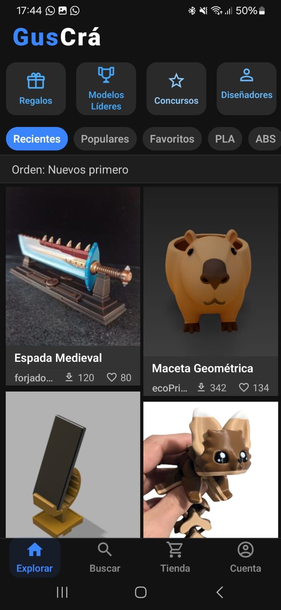
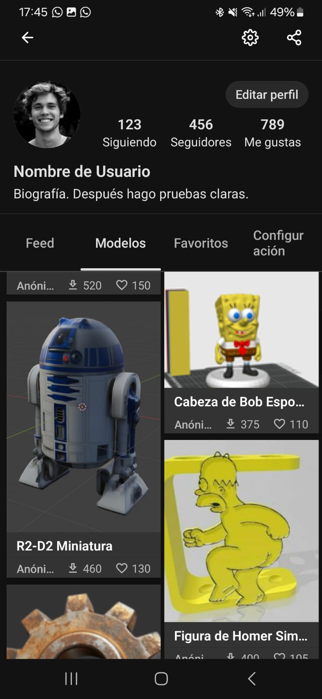
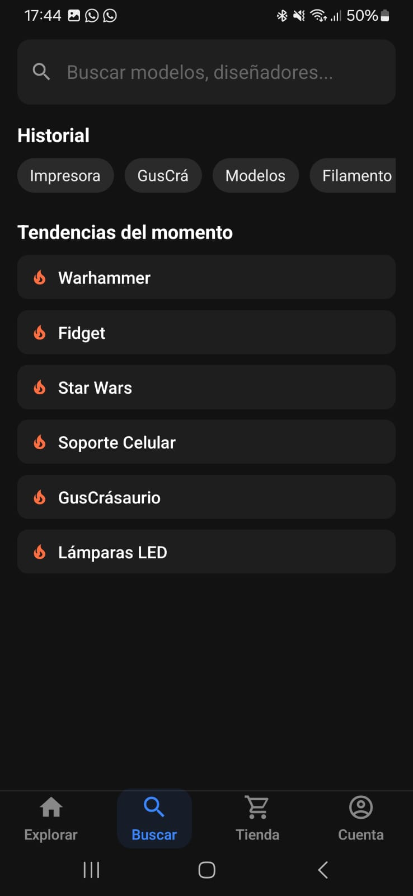
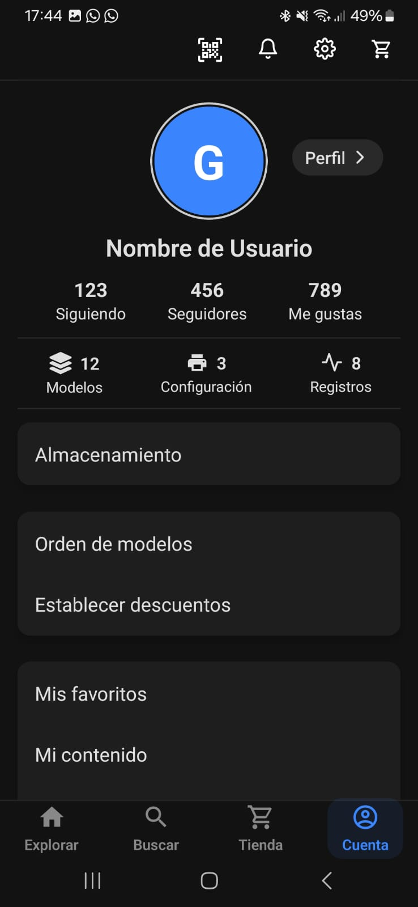
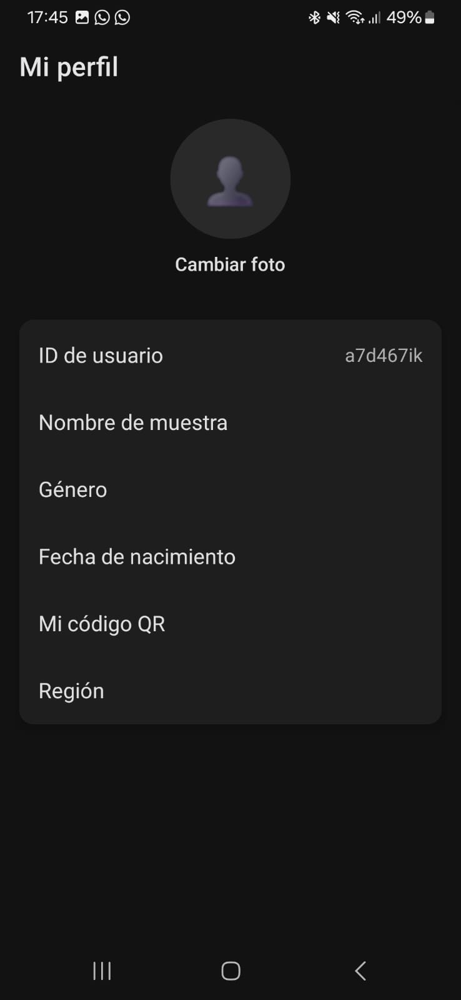

<div align="center">

# 🎨 Market 3D

### Una experiencia móvil para descubrir y compartir diseños 3D

**Proyecto académico · Frontend mobile**

  

</div>

---

## 📱 Sobre el proyecto

**Market 3D** es un prototipo de aplicación móvil inspirado en la experiencia de navegación de redes sociales como Instagram, pero enfocado en la **publicación, exploración y exhibición de diseños 3D**.

Fue desarrollado como proyecto académico utilizando **React Native y Expo Go**, con énfasis en el diseño de interfaces, la navegación entre pantallas y la organización del código en módulos y componentes reutilizables.

> **Alcance:** este repositorio corresponde al **frontend**. Las pantallas y flujos visuales no implican que exista un backend, almacenamiento remoto, autenticación real o persistencia de publicaciones.

## ✨ Funcionalidades e interfaces

- **Inicio / feed:** exploración de publicaciones de diferentes usuarios.
- **Visitantes y usuarios registrados:** interfaces adaptadas a ambos escenarios.
- **Publicaciones:** pantalla de detalle de cada diseño.
- **Perfil:** información del usuario, publicaciones, seguidores y seguidos.
- **Interacciones:** secciones visuales de «Me gusta» y otras pestañas de perfil.
- **Carga de diseños:** interfaz para agregar archivos y publicaciones.
- **Configuración:** pantallas de ajustes de usuario.
- **Componentes reutilizables:** estructura modular para facilitar el mantenimiento.


## 🖼️ Capturas de pantalla

<div align="center">

<table>
  <tr>
    <td align="center"><strong>Feed</strong></td>
    <td align="center"><strong>Publicaciones</strong></td>
    <td align="center"><strong>Búsqueda</strong></td>
  </tr>
  <tr>
    <td align="center">
      
    </td>
    <td align="center">
      
    </td>
    <td align="center">
      
    </td>
  </tr>
</table>

<table>
  <tr>
    <td align="center"><strong>Cuenta</strong></td>
    <td align="center"><strong>Configuración</strong></td>
  </tr>
  <tr>
    <td align="center">
      
    </td>
    <td align="center">
      
    </td>
  </tr>
</table>

</div>

## 🛠️ Tecnologías

| Tecnología | Uso |
|---|---|
| **React Native** | Construcción de interfaces móviles |
| **Expo / Expo Go** | Entorno de desarrollo y pruebas en dispositivo |
| **JavaScript** | Lógica e interacciones de la interfaz |
| **Componentes reutilizables** | Organización y reutilización de elementos visuales |

> Si el código actual utiliza **TypeScript** o **Expo Router**, actualizá esta tabla para reflejarlo. No los incluí como hechos confirmados.

## 🧩 Organización del proyecto

El frontend fue organizado separando pantallas y componentes para facilitar la reutilización y el mantenimiento. La estructura exacta puede variar según la versión del repositorio.

## 🚀 Ejecutar localmente

### Requisitos

- Node.js y npm instalados.
- Aplicación **Expo Go** en un teléfono compatible, o un emulador configurado.

```bash
# Clonar el repositorio
git clone https://github.com/GusSantillan24/market-3d-frontend.git

# Entrar al proyecto
cd market-3d-frontend

# Instalar dependencias
npm install

# Iniciar Expo
npx expo start
```

Abrí Expo Go y escaneá el código QR que aparece en la terminal, siguiendo las indicaciones de Expo. La compatibilidad con versiones actuales de Expo Go depende del SDK utilizado por el proyecto.

## 📚 Aprendizajes

- Desarrollo de interfaces móviles con React Native.
- Navegación y composición de pantallas.
- Diseño de interfaces inspiradas en productos reales.
- Organización modular y reutilización de componentes.
- Desarrollo y pruebas con Expo Go.

## 👨‍💻 Autor

**Gustavo Santillán** · Estudiante de Tecnicatura Universitaria en Programación (UTN)

[GitHub](https://github.com/GusSantillan24) · [LinkedIn](https://www.linkedin.com/in/gus-santillan-it) · [Email](mailto:santillangustavo.it@gmail.com)
